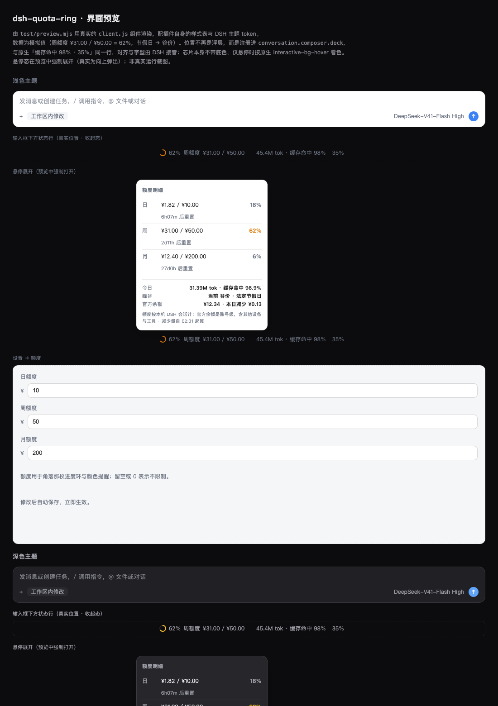

# dsh-quota-ring（额度环）

[](https://github.com/wjhkazuto-lang/dsh-quota-ring/actions/workflows/ci.yml)
[](LICENSE)
[](#%E7%8E%AF%E5%A2%83%E8%A6%81%E6%B1%82)


DeepSeek Harness 的额度插件：**在输入框下方的状态行里常驻一枚小进度环**，把你在设置里定的日/周/月额度显示成一目了然的占用率。悬停展开明细。



```
输入框下方状态行（真实位置）：

   ◔ 62% 周额度 ¥31.00 / ¥50.00     45.4M tok · 缓存命中 98%     35%
   └── 本插件 ────────────────┘     └── DSH 原生 ──────────────────┘

悬停时向上弹出：

   ┌──────────────────────────────┐
   │ 额度明细                      │
   │ 日  ¥1.82 / ¥10.00    18%     │
   │     6h07m 后重置              │
   │ 周  ¥31.00 / ¥50.00   62%     │
   │     2d11h 后重置              │
   │ 月  ¥12.40 / ¥200.00   6%     │
   │     27d0h 后重置              │
   │ ────────────────────────────  │
   │ 今日   31.39M tok · 缓存命中 98.9% │
   │ 峰谷   当前 谷价 · 法定节假日   │
   └──────────────────────────────┘
              ▲
   ◔ 62% 周额度 ¥31.00 / ¥50.00
```

## 功能

- **输入框下方状态行常驻小进度环**，固定显示**周额度**占用率。颜色只在需要提醒时才出现：**中性**（<60%）≤ **黄**（<90%）≤ **红**（≥90%）。
- **融入原生 UI**：注册进 `conversation.composer.dock`（输入框下方那一行），和原生「缓存命中 98% · 35%」并排。对齐、间距、字型、**颜色**全部与原生状态项一致 —— 整枚芯片统一用 `--dsw-alias-label-tertiary`，圆环轨道用最浅的 `--dsw-alias-border-l1`，芯片本身**不带底色、不带边框、不带阴影**，静止时只是一个行内状态项，鼠标悬停才按原生 `interactive-bg-hover` 着色并弹出明细。
- **舒适态不抢眼**：额度低于 60% 时圆环保持中性灰（和 DSH 原生的用量环一致，它在 45% 时也是灰的），只有进入黄/红区间才上色。
- **悬停展开明细**：日/周/月三行各自的已用 / 额度 / 百分比 / 重置倒计时，加上今日 token 量与缓存命中率、当前峰谷状态。超额时多出一行超额金额。
- **设置页「额度」分区**：只有日/周/月三个输入框，改完自动保存立即生效。默认 ¥10 / ¥50 / ¥200。
- **按官方人民币峰谷价目表计费**（见下），统计全机所有会话的消耗，含子代理。
- **启动回填最近 35 天**，装完立刻能看到今天已经花了多少，不用等新请求。
- **只提醒，不拦截**：超额只变色，不会阻止你继续发消息。
- **官方余额对账**：并排显示账号级余额与本日变化，让本机口径和平台用量页的差额一目了然（可关闭，见「两种口径」）。

## 计费规则

严格按官方《模型 & 价格》脚注 (2)：

> 北京时间**周一至周五（不含中国法定节假日）9:00–12:00、14:00–18:00** 为高峰时段；
> 其余时段，包括**周末及中国法定节假日全天**均为空闲时段。
> **空闲时段价格为高峰时段价格的一半。**

所以判定链是：

1. 周末（北京日历日的周六/周日）→ 全天谷价
2. 中国法定节假日（北京日历日）→ 全天谷价
3. 否则，落在 UTC `[1,4)` 或 `[6,10)` 小时 → 峰价（即北京 09:00–12:00 / 14:00–18:00）
4. 其余 → 谷价

**调休补班日不需要单列**：它们全都落在周末，而周末本来就全天谷价。

官方人民币价目表（元 / 百万 token）：

| 档位 | 缓存命中 | 缓存未命中 | 输出 |
|---|---|---|---|
| 谷价 | ¥0.02 | ¥1 | ¥4 |
| 峰价 | ¥0.04 | ¥2 | ¥8 |

金额计算：

```
金额 = 缓存读 × 命中价 + (未缓存输入 + 缓存写入) × 未命中价 + (输出 + 推理) × 输出价
```

按**每条请求的发生时刻**取价，再累加 —— 跨峰谷的会话不会被"当前时段单价 × 整段用量"算错。

## 额度周期

按**本机时区**的自然周期，周从**周日 00:00** 开始：

| 周期 | 窗口 |
|---|---|
| 日 | 当天本地 00:00 → 次日 00:00 |
| 周 | 本周日 00:00 → 下周日 00:00 |
| 月 | 当月 1 日 00:00 → 次月 1 日 00:00 |

## 安装

```bash
# 从 GitHub（推荐）
dsh plugin --profile desktop add github:wjhkazuto-lang/dsh-quota-ring

# 从本地目录
dsh plugin --profile desktop add /path/to/dsh-quota-ring

# 从 npm
dsh plugin --profile desktop add dsh-quota-ring
```

装好后**重启 DSH**。桌面版请 ⌘Q 完全退出再打开。

卸载：

```bash
dsh plugin --profile desktop remove dsh-quota-ring
```

### 环境要求

- **DSH** `>= 0.2.0-rc.1`（`dsh.bundle` / `dsh.client` 清单契约）
- **Node** `>= 22.15`。DSH 把会话日志存成 zstd 压缩的 JSONL，逐帧解压依赖 Node 22.15+ / 24 的 `zlib.zstdDecompressSync`；低于这个版本插件仍能实时计费，但**启动回填会读不到历史**。
- 无需任何 API Key。**默认只在读取官方账户余额时联网**（走 DSH 自己的账号服务，插件本身不发 HTTP 请求）；把行配置里的 `balanceReconcile` 设为 `false` 即**完全不联网**。

## 配置

**设置 → 额度**：只有日/周/月三个额度输入框。这里的值存在账本里，优先级高于行配置的默认值。

**高级项**在插件行配置（`cordis.patch.yml` 的 `config`）里：`thresholds`、`peakEnabled`、`peakWindows`、`holidays`、`prices`、`backfillDays`、`retentionDays`、`balanceReconcile`、`balanceRefreshMinutes`、`balanceRetrySeconds`、`refreshSeconds`。改完需要重新安装并重启（见下）。

## 年度维护：节假日表

`holidays` 是**唯一需要每年更新**的东西。国务院办公厅通常在每年 11 月发布次年安排，届时把日期追加进行配置即可，不必改代码。

表里**只列放假的日期**。漏录不会报错，但会把工作日假期误判成峰价（多算钱），所以插件启动时会自检并在日志里提醒缺失的年份；悬停面板也会显示一行警告。

当前覆盖：**2026 年**（元旦 1/1–1/3、春节 2/15–2/23、清明 4/4–4/6、劳动 5/1–5/5、端午 6/19–6/21、中秋 9/25–9/27、国庆 10/1–10/7）。

## 在 DSH 界面里哪里找它

DSH 有**两个**都叫「插件」的地方，容易混：

| 位置 | 是什么 | 本插件在哪 |
|---|---|---|
| 侧栏「插件」 | 第三方在线**插件市场**（远端目录，缓存里 12458 个已发布插件） | **不可能出现** —— 本插件是本地 `file:` 安装，从未发布。要管理它请切到市场页的「**已安装**」，来源筛选选「全部」或「自定义安装」，会以「自定义」标记出现 |
| 设置 →「插件」 | DSH 原生的**插件列表**（按 Loader 条目分组为「全局插件 / 会话插件」） | 有，卡片标题显示为 **额度环 (dsh-quota-ring)**。它在列表**最下面**（是 profile 里第 15 个、也是最后一个 bundle），直接搜索 `quota` 更快 |

原生列表的卡片标题/描述/图标**不是**写死的，而是由宿主读取包自身元信息得到（`dsh-app-boot` 的 `readPluginMeta`）：

1. `<包>/locale/en.json` —— 字典锚点，**缺了它其它语言文件全部被忽略**；同目录下的其它 `<lang>.json` 一并读取
2. 每个语言文件的形状是 `{ "meta": { "title": ..., "description": ... } }`，字段必须是非空字符串
3. 标题取 `meta.title`，缺失时回退到 `package.json` 的 `name`；描述同理回退到 `description`
4. 图标取 `package.json` 的 `icon`（相对路径，SVG/PNG/JPEG/WebP，≤256 KiB，且必须留在包目录内）
5. 这些资源都是**通过包的 `exports` 解析**的，所以必须导出 `./package.json` 与 `./locale/*.json` —— 少一个就会静默退化成裸包名

`test/check.mjs` 有一组断言专门盯这份契约（图标可解析且够小、locale 形状正确、en.json 存在、exports 齐全、`files` 里带上资源、标题保留包名以便搜索），因为这些都很容易在后续改动中被无声破坏。

## 两种口径：本机 vs 账号

这是最容易困惑的地方，所以插件把两个数字**并排显示**而不是只显示一个。

| 口径 | 含义 | 谁提供 |
|---|---|---|
| **本机** | 这台机器上 DSH 的**全部会话**（含子代理）的消耗，按官方价目表换算 | 插件自己统计 |
| **账号级** | DeepSeek 平台账户的余额变化，**含所有设备、所有工具** | `deepseekAccount` 服务 |

两者**永远不会相等**，因为账号级还会包含：

- 你在别的设备/工具上用同一个账号的消耗
- DSH **没有记录 usage** 的计费调用 —— 会话标题生成（`session/title-llm-request`）与联网搜索的模型调用（`web/deepseek-search-llm-request`）。实测这两类很便宜（约 ¥0.01–0.04/天），但确实存在，任何基于会话日志的统计（包括 dsh-cost-meter）都看不到它们。

悬停面板里会显示成这样：

```
官方余额 · 账号级        ¥12.34 · 本日减少 ¥0.13 · 自 09:12
额度按本机 DSH 会话计；官方余额是账号级，含其他设备与工具。
```

**为什么同时保留两种取法**：`deepseekAccount` 是 profile 树里的**兄弟行**。实测两种情况都会发生：

- **刚启动时**：本插件那次读取可能跑在账号行注册之前，`ctx.get('deepseekAccount')` 返回 `undefined`。这是**竞态**，不是「服务不存在」——第一版文案写成「当前构建没有该服务」，是**误导**，已改正。
- **账号行注册之后**：`ctx.get('deepseekAccount')` 是能拿到的（实测 `status: ready`，余额正常）。

所以现在的做法是：

1. **首次未命中一律先当作竞态** —— 状态留在「读取中」而不弹错误，约 2 秒后重试；只有**连续**未命中才报「始终未就绪」（用尝试计数判断，不能用 `status === 'loading'` 判断，否则失败的重试会永远停在 loading）。
2. 同时用 `ctx.inject(['deepseekAccount'], cb)` 挂一个**子 fiber**：服务就绪时主动捕获并立刻读一次。用注入而非硬 `inject`，是因为非桌面（web）profile 上可能没有该服务，硬 inject 会让整个插件不激活。
3. **两条路都留着**。这次踩的坑正是：我一度把可用的直接查找**整个换成** inject，等于把一次瞬时未命中升级成单点故障。

**读到失败不会只显示一句「不可用」**：宿主会把原因原样带上来（服务不存在 / 未登录 / 查询抛错并注明重试次数），因为「服务缺失」「未登录」「平台查询失败」长得一样的话，下次排查等于从零开始。余额查询打的是 `platform.deepseek.com`，该域名在开了 HTTPS 解密的机器上会**间歇性** TLS 失败，所以读到失败会重试 3 次；仍失败时，后续每次状态请求（间隔超过 `balanceRetrySeconds`，默认 30 秒）都会再试一次，自愈而不是等满一个刷新周期。

**「自 HH:MM」而不是「本日」**：基线是当天**第一次成功读到余额**的时刻，不一定在本地午夜（除非那时 DSH 正好开着）。所以显示具体时刻，不假装覆盖全天。当天有充值时会显示「本日有充值」而不是把负的差值当成消费。

要对得上官方用量页，请以账号级为准；本机数字用来看「我今天在这台机器上花了多少」。

## 数据

- 账本：`$DSH_HOME/storages/quota-ring/ledger.json`
- 账本里存的是**按档位与模型拆分的 token**，不是金额。所以改价目表会**重算全部历史**，而不是留下过期的旧金额。
- 只读会话日志（`$DSH_HOME/sessions/`）用于启动回填，不写、不改。
- 无遥测。唯一的联网行为是读取官方账户余额（见下），可用 `balanceReconcile: false` 关掉。

## 结构

```
package.json         清单：dsh.bundle.patch + dsh.client
cordis.patch.yml     插入 quota-ring 这一行 Loader 条目 + 全部高级配置
lib/quota.mjs        纯逻辑：价目表、峰谷判定、额度周期、计费与额度评估
lib/index.js         Host 半边：回填会话日志、订阅 session/event、账本落盘、两条路由
client.js            Client 半边：状态行芯片 + 设置页（手写 plain JS，无构建步骤）
test/check.mjs       38 项纯逻辑自检（含显示/发布元信息与文档契约）
test/smoke.mjs       37 项 Host 端到端自检（模拟 Cordis ctx 真正启动插件）
test/render-check.mjs 44 项 Client 渲染自检（最小 React 运行时跑真实组件）
test/preview.mjs     把真实组件渲染成 test/preview.html 供肉眼查看
```

Host 与浏览器之间只有两条同源 JSON 路由：

- `GET /__quota-ring/state` → 当前周期、额度、峰谷状态、元信息
- `POST /__quota-ring/config` → 写回三个额度（带同源校验，跨源返回 403）

## 自检

```bash
npm test          # 三套一起跑，共 119 项断言
npm run check     # 两个半边的语法校验
npm run preview   # 生成 test/preview.html
```

- `test/check.mjs` 里两组金额 fixture 是 dsh-cost-meter 归档账本中 **2026-10-03 与 10-04 的真实用量**，用本插件价目表重算必须得到 ¥1.81887776 与 ¥0.49097356。
- `test/smoke.mjs` 用一次性 `DSH_HOME`（`sessions/` 软链到真实日志）真正启动 Host 半边，验证回填、两条路由、跨源拒绝、账本落盘与 `seq` 幂等；另在隔离的合成 home 上验证**子代理会话计入同一额度**（子代理独享 home 必须恰好计 ¥2），以及**节假日表缺年时启动告警**。
- `test/render-check.mjs` 用最小 React 运行时执行真实 `client.js`，验证两个席位注册、进度环弧度与配色、悬停面板三行明细与倒计时、超额行、节假日警告，以及设置页三个输入框。

## 已知说明

- **profile 里存的是硬链接副本**（与源码同 inode，链接数 2）。因此**原地写入**（如 `python3 - <<PY` 重写）会立刻反映到已装副本；而先写临时文件再 rename 的工具会切断硬链接，使已装副本变旧，此时需要 remove + add 重新链接。因此：**原地写入**（如 `python3 - <<PY` 重写文件）会立刻反映到已装副本，不必重装；但**替换文件的编辑器/工具**（`write`/`edit` 这类先写临时文件再 rename 的）会切断硬链接，使已装副本变旧，此时需要 remove + add 重新链接（直接重复 add 会报 `ambiguous-install`）。判断方法：比 inode（`stat -f '%i'`）而不是只比哈希。
- **宿主半边的改动必须完全重启 DSH 才会生效**。这条踩过坑：热重载会重新挂载 fiber（日志、账本都动起来了），但 Electron 主进程的 **Node ESM 模块缓存**仍然命中进程内**最早导入的那份 `lib/index.js`**，磁盘上的新代码不会被执行。判断方法：对着 `GET /__quota-ring/state` 看 `meta` 的键是否符合新代码 —— 如果不符合，就是缓存，需要 ⌘Q 重启。
  - **客户端半边相反**：浏览器按 `/plugins/??<id>/client.js&rev=<hash>` 走 HTTP 取 bundle，`rev` 是文件 stat 的哈希，所以改完 `client.js` 只需**刷新页面**。
  - 所以开发时的循环是：改 `client.js` → 刷新页面；改 `lib/*.js` → ⌘Q 重启。
- **客户端半边必须声明依赖**（v0.1.0 已修）。这是最难查的一个坑：**重启后整个界面半边消失，热安装却正常**，看起来像随机。根因是 `client.js` 里那段 `const slots = ctx.get('slots'); if (!slots) return` —— 冷启动时客户端的 bundle 可能**先于 `slots` 服务**执行，`apply()` 于是直接提前返回，**两个席位一个都没注册**（注意：是"两个都没"，不是只丢一个，这正是提前返回的指纹）。热安装时页面早已启动完毕，`slots` 一定存在，所以完全正常。修法有两层，缺一不可：
  - 插件对象声明 `inject: ['slots']` —— 让 Cordis **等服务就绪再调用 apply**，而不是靠运气；
  - `package.json` 的 `dsh.client.inject` 列出 `@deepseek-ai/dsh-client-ui-slots` 等包 —— 让客户端模块图**把你排在提供这些服务的包之后**。
  对照过 `dsh-better-sidebar` / `dsh-context`，它们都声明了；本插件最初只写了 `{ platform: 'web' }`，所以中招。`test/render-check.mjs` 与 `test/check.mjs` 各有一条断言盯住这两处声明。
- **路由必须在 `ctx.effect` 里注册**（v0.1.0 已修）。这是踩过的坑：早期版本把 `webServer.register` 写在 effect 外面，插件被 dispose 时路由不释放，于是热重载时新实例报 `webserver: duplicate exact route` 起不来，而旧实例的监听器已被回收 —— 结果是路由还在响应、但数据永远停在某个时刻不再更新。现在是 `ctx.effect` 包住路由与事件订阅，`test/smoke.mjs` 有两条回归测试专门盯这个（dispose 必须释放路由；dispose 后必须能重新 apply）。注意修复**无法自我生效**：当时正在运行的那个旧实例不会因为文件更新而改变，必须先让它退出（一次 `remove` 即可，本次实测就是这样恢复的；重启当然也可以），之后热重载才恢复正常。
- **安装即热生效**。实测本次安装后 Host 半边立刻激活（无需重启），`shell.overlay` 与 `settings.section` 两个席位也立即出现在页面上；但官方文档与同类插件均建议桌面版重启一次以防万一。
- **只在会话页显示**。`conversation.composer.dock` 是会话作用域的席位，没有输入框的页面（设置页、插件页、空白首页）不会有这一行，因此芯片也不显示。这是把位置交给原生状态行换来的代价 —— 之前用 `shell.overlay` 可以全页面常驻，但浮层无法真正「属于」任何布局，看起来总是贴在界面之上。
- 未覆盖的年份不会被误判为节假日，但工作日假期会按峰价计算，因此有启动日志提醒与面板警告。

## 开发

```bash
npm install        # 只装一个 devDependency：yaml（用于读取 cordis.patch.yml）
npm run check      # 两个半边的语法校验
npm test           # 三套一起跑，共 119 项断言
npm run preview    # 渲染 test/preview.html
```

测试是**可移植的**：裸检出机器上没有 DSH 会话日志、也没有 `yaml` 时，依赖真实数据的用例会 **skip 并说明原因**，而不是报失败。CI 在 Node 22.15 / 24 两档上跑。

没有构建步骤 —— 浏览器半边是手写的 plain JS，直接由 `dsh.client` 指向 `client.js`。

## 许可

[MIT](LICENSE) © 2026 翌yi

本项目是独立的社区插件，与 DeepSeek 官方无隶属关系。DeepSeek、DeepSeek Harness 是 DeepSeek 的商标。
